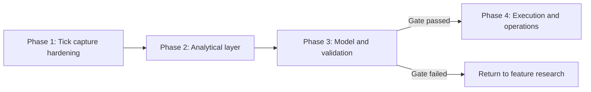

# Project Roadmap — IQ Option Bot

Status: Current

> The build order was: make the tick stream trustworthy, build the analytical layer, build and validate a model, then add execution and operations. The first three layers now exist as code; validation on real data has not happened, and execution is paper-only.

---

## Vision

Build a documentation-driven IQ Option system that captures live ticks, reconstructs market features, trains and validates ML models, loads versioned models for inference, and uses an ML-based signal decision layer. Progress from research through shadow and paper evaluation before any separately gated demo/live operation, with deterministic risk and execution constraints.

The project succeeds only if the model clears the validation gate. A working pipeline with no edge is a valid research outcome, not a failure.

---

## Current State

| Layer | State |
|-------|-------|
| Tick capture | Live receiver; `serve` streams accepted events to the stream store |
| Persistence | Hour-partitioned event/candle Parquet parts, state recovery, decision/trade JSONL journals; file inputs remain supported |
| Candles | Whole-minute candle builder in `engine/stream/`, persisted as parts |
| Snapshots | Candle-close cadence, continuity-gated completed-candle window, delayed entry, per-horizon exits |
| Features | `amt-v4` diagnostics, `core16-v2` model vector, stateless |
| Labels | `snapshot-horizon-v1`, ties and missing exits explicit |
| Models | Four calibrated LightGBM classifiers, purged walk-forward |
| Model artifact | Timestamped `.joblib` plus manifest; runtime validates hash and compatibility; legacy pickle remains for analysis/backtest |
| Router | Deterministic payout-aware EV hurdle, explicit no-trade; not ML-based |
| Backtest | Held-out replay through a paper broker |
| Execution | Paper only |
| Runtime gates | Paper-only, one open trade, configured cooldown and daily loss stop; not a complete risk manager |
| Tests | 159 unit tests currently pass; see [Testing Strategy](system/05_TESTING.md) |

No real capture has produced a result distinguishable from noise. The core hypothesis remains open.

The candle-close runtime and validated `.joblib` loading are implemented. The learned direction/horizon/no-trade selector remains planning work and must be evaluated against the current per-horizon models plus deterministic EV router. Passing tests do not establish real-feed validity or a trading edge.

---

## Phases at a Glance

| Phase | Objective | Primary Output | Status |
|-------|-----------|----------------|--------|
| 1 | Tick capture hardening | Trustworthy, persistent tick stream | Partial |
| 2 | Candles, features, labels | Analytical layer and dataset | Implemented offline |
| 3 | Model and validation | Calibrated suite, honest backtest, go/no-go | Built; not validated on real data |
| 4 | ML runtime, signal selection, and staged operations | Runtime and paper decisions implemented; selector evaluation, sustained shadow/paper validation, risk controls, and any separate demo/live readiness remain | In progress |

---

## Dependency Map

- Phase 2 code exists; it depends on Phase 1 only for trustworthy input data.
- Phase 3 code exists; its results depend on a real multi-day capture.
- Runtime paper research can proceed before the gate; demo/live execution must not begin until the validation and separate safety/readiness gates pass.

---

## Milestones

| Milestone | Phase | Description | State |
|-----------|-------|-------------|-------|
| M1 | 1 | Tick contract verified; `at` semantics documented | Open |
| M2 | 1 | Raw ticks persisted and replayable | Done |
| M3 | 1 | Data-quality counters and gap tracking | Partial |
| M4 | 2 | Minute bucketing and continuity gate pass invariant tests | Done |
| M5 | 2 | TPO/Value Area matches worked examples | Done |
| M6 | 2 | Feature engine and labels versioned | Done |
| M7 | 3 | Dataset and four calibrated horizon models trained | Done |
| M8 | 3 | Purged walk-forward and held-out evaluation reported | Done |
| M9 | 3 | Rule-based AMT baseline compared | Open |
| M10 | 3 | Go/no-go decision recorded on real captures | Open |
| M11 | 4 | Risk controls and kill switch | Open |
| M12 | 4 | Paper/demo execution with reconciliation | Open |
| M13 | 4 | Monitoring, alerts, tested runbook | Open |
| M14 | 4 | Live readiness review | Open |
| M15 | 4 | Versioned `.joblib` artifact contract and fail-closed runtime loading documented and implemented | Done |
| M16 | 4 | Learned selector evaluated against the deterministic EV-router baseline on untouched chronological data | Open |
| M17 | 4 | Shadow and sustained live-paper inference validated against offline replay | Open — runtime code exists; sustained evidence not collected |

---

## Risks

| Risk | Impact | Likelihood | Mitigation |
|------|--------|------------|------------|
| AMT has no edge on OTC data | High | Medium | Rule-based baseline; validation gate; stop if unsupported |
| Broker changes the feed or pricing algorithm | High | Medium | Schema drift detection; separate captures; drift monitoring |
| Timestamp semantics are wrong | High | Medium | Local `received_at`; `at` never promoted; replay tests |
| Repeated frames inflate tick density | Medium | Medium | Events are preserved; report repeated timestamp/price patterns and validate against real captures |
| Weekend synthetic regime | Medium | High | Weekend flag; separate evaluation; no weekend trading initially |
| Overfitting | High | High | Walk-forward; purge; held-out evaluation; calibration |
| Payout changes | Medium | Medium | Configured payouts; re-evaluate EV when they change |
| Data loss on disconnect | Medium | Medium | Sequenced event persistence, stream recovery, late/gap counters, and bounded extension queue |
| Execution bug | High | Medium | Paper only today; risk layer before any demo adapter |
| Platform or legal restriction | High | Low–medium | Review terms and jurisdiction before live trading |

---

## Decision Points

1. **Is the tick contract good enough?** If frame semantics cannot be verified, the feature layer rests on an assumption that must be stated in every result.
2. **Does a real capture reproduce the pipeline?** Run `diagnose`, `build`, `train`, `backtest` on multi-hour captures and inspect exclusions.
3. **Is the edge real?** Apply the gate in [Model validation](system/09_MODEL_VALIDATION.md) without adjusting it after seeing results.
4. **Is a rule-based baseline beaten?** If not, the ML layer is not adding value.
5. **Is execution worth building?** Only after a positive, stable, payout-aware result.

---

## Open Questions

- What are the exact semantics of `msg.at`?
- Is the intercepted frame a tick, a partial-candle update, or a completed candle?
- Which instrument universe and expiry durations come first?
- Is payout data available dynamically, or must it stay configured?
- What is the real tick cadence, and what `min_ticks_per_bar` does it justify?
- Does the two-stage regime design beat the flat four-horizon suite?
- What target and candidate inputs should train the learned direction/horizon/no-trade selector?
- What artifact scope and manifest are required for per-horizon or shared models?
- What sample sufficiency and independent-capture evidence are required before selector promotion?
- What are the risk limits and kill-switch rules?
- Which execution route is available and permitted?

---

## Related Documentation

- [Limitations and backlog](system/10_LIMITATIONS_AND_BACKLOG.md)
- [System overview](system/01_OVERVIEW.md)
- [Data pipeline](system/07_DATA_PIPELINE.md)
- [ML pipeline](system/08_ML_PIPELINE.md)
- [Model validation](system/09_MODEL_VALIDATION.md)
- [Phase 1: Tick capture hardening](planning/phase-1-tick-capture-hardening.md)
- [Phase 2: Candles and AMT features](planning/phase-2-candles-and-amt-features.md)
- [Phase 3: ML pipeline and validation](planning/phase-3-ml-pipeline-and-validation.md)
- [Phase 4: ML runtime, execution, and operations](planning/phase-4-execution-and-operations.md)
- [ML runtime and signal selection](planning/ml-runtime-and-signal-selection.md)
- [Streaming runtime and store](system/16_STREAMING_RUNTIME_AND_STORE.md)

---

*Last updated: 2026-11-21*
