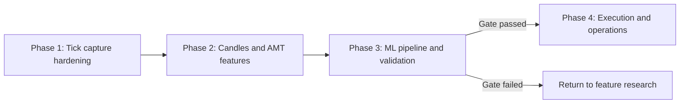

# Project Roadmap — IQ Option Bot

Status: Planning

> The roadmap follows the actual build order: make the tick stream trustworthy, build 1-minute candles and AMT features, validate a model, then add execution and operations.

---

## Vision

Build a documentation-driven, locally operated IQ Option trading bot that captures live ticks, reconstructs auction-style market structure, tests a payout-aware predictive model with rigorous out-of-sample validation, and only then executes trades through a paper/demo-first execution layer with hard risk controls.

The project is successful only if the model clears the validation gate. A working pipeline with no edge is a valid research outcome, not a failure.

---

## Current State

- Live tick capture through a Chrome extension and Python receiver works as a proof of concept.
- The receiver buffers 500 raw messages per `active_id` in memory.
- There is no persistence, candle aggregation, AMT feature engine, ML pipeline, risk layer, or execution layer.
- Documentation now defines the target architecture and the improvement backlog.

---

## Phases at a Glance

| Phase | Objective | Primary Output | Status |
|-------|-----------|----------------|--------|
| 1 | Tick capture hardening | Trustworthy, persistent tick stream | Planned |
| 2 | 1-minute candles and AMT features | Candle builder, TPO/Value Area, feature engine, rule-based baseline | Planned |
| 3 | ML pipeline and validation | Versioned dataset, two-stage model, calibration, go/no-go report | Planned |
| 4 | Execution and operations | Paper/demo execution, risk controls, monitoring, runbook | Planned |

---

## Dependency Map

- Phase 2 cannot start until Phase 1 acceptance criteria are met.
- Phase 3 can begin exploratory work while Phase 2 is finishing, but the final dataset depends on Phase 2 outputs.
- Phase 4 execution work cannot start until Phase 3 passes the validation gate.

---

## Milestones

| Milestone | Phase | Description |
|-----------|-------|-------------|
| M1 | 1 | Tick contract verified; `at` semantics documented |
| M2 | 1 | Raw ticks persisted and replayable |
| M3 | 1 | Data-quality metrics and gap tracking active |
| M4 | 2 | 1-minute candles pass invariant tests |
| M5 | 2 | TPO/Value Area matches worked examples |
| M6 | 2 | Rule-based AMT baseline backtested |
| M7 | 3 | Versioned dataset and two-stage model trained |
| M8 | 3 | Walk-forward validation and calibration reported |
| M9 | 3 | Go/no-go decision recorded |
| M10 | 4 | Paper/demo execution with risk limits |
| M11 | 4 | Monitoring, alerts, and tested runbook |
| M12 | 4 | Live readiness review |

---

## Risks

| Risk | Impact | Likelihood | Mitigation |
|------|--------|------------|------------|
| AMT has no edge on OTC data | High | Medium | Rule-based baseline; validation gate; stop if unsupported |
| Broker changes the feed or pricing algorithm | High | Medium | Schema drift detection; drift monitoring; small size |
| Timestamp semantics are wrong | High | Medium | Record receipt time; verify `at`; replay tests |
| Tick density is biased | Medium | Medium | Dedupe rules; multiple bin sizes; sensitivity analysis |
| Weekend synthetic regime | Medium | High | Weekend flag; separate evaluation; no weekend trading initially |
| Overfitting | High | High | Walk-forward; purge/embargo; calibration; baseline comparison |
| Payout changes | Medium | Medium | Record payout per trade; re-evaluate EV |
| Data loss on disconnect | Medium | Medium | Raw capture; gap tracking; queue metrics |
| Execution bug | High | Medium | Paper/demo first; idempotency; kill switch; audit log |
| Platform or legal restriction | High | Low–medium | Review terms and jurisdiction before live trading |

---

## Open Questions

- What are the exact semantics of `at`?
- Is the intercepted frame a tick, a partial-candle update, or a completed candle?
- Which instrument universe and expiry durations are first?
- Is payout data available dynamically?
- Is a live spot FX feed available for comparison?
- Which model library will be primary?
- What are the risk limits and kill-switch rules?
- Which execution route is available and permitted?

---

## Related Documentation

- [Limitations and backlog](system/10_LIMITATIONS_AND_BACKLOG.md)
- [System overview](system/01_OVERVIEW.md)
- [Data pipeline](system/07_DATA_PIPELINE.md)
- [ML pipeline](system/08_ML_PIPELINE.md)
- [Model validation](system/09_MODEL_VALIDATION.md)

---

*Last updated: 2026-11-18*
