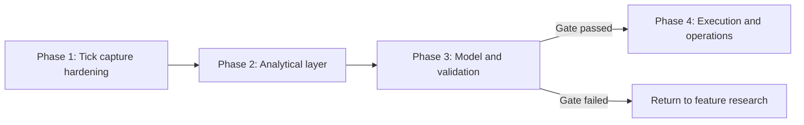

# Project Roadmap — IQ Option Bot

Status: Current

> The build order was: make the tick stream trustworthy, build the analytical layer, build and validate a model, then add execution and operations. The first three layers now exist as code; validation on real data has not happened, and execution is paper-only.

---

## Vision

Build a documentation-driven, locally operated IQ Option trading bot that captures live ticks, reconstructs auction-style market structure, tests a payout-aware predictive model with rigorous out-of-sample validation, and only then executes trades through a paper/demo-first execution layer with hard risk controls.

The project succeeds only if the model clears the validation gate. A working pipeline with no edge is a valid research outcome, not a failure.

---

## Current State

| Layer | State |
|-------|-------|
| Tick capture | Live; buffered and optionally persisted as daily JSONL |
| Persistence | JSONL capture plus Parquet store |
| Candles | Whole-minute bucketing inside the build; no candle store |
| Snapshots | Continuity-gated, delayed entry, per-horizon exits |
| Features | `amt-v3` table, `core16-v1` model vector, stateless |
| Labels | `snapshot-horizon-v1`, ties and missing exits explicit |
| Models | Four calibrated LightGBM classifiers, purged walk-forward |
| Router | Payout-aware EV hurdle, explicit no-trade |
| Backtest | Held-out replay through a paper broker |
| Execution | Paper only |
| Risk | Fixed stake, one open trade; nothing else |
| Tests | 111 unit tests passing |

No real capture has produced a result distinguishable from noise. The core hypothesis remains open.

---

## Phases at a Glance

| Phase | Objective | Primary Output | Status |
|-------|-----------|----------------|--------|
| 1 | Tick capture hardening | Trustworthy, persistent tick stream | Partial |
| 2 | Candles, features, labels | Analytical layer and dataset | Implemented offline |
| 3 | Model and validation | Calibrated suite, honest backtest, go/no-go | Built; not validated on real data |
| 4 | Execution and operations | Demo/live adapters, risk controls, monitoring | Not started |

---

## Dependency Map

- Phase 2 code exists; it depends on Phase 1 only for trustworthy input data.
- Phase 3 code exists; its results depend on a real multi-day capture.
- Phase 4 must not start until the validation gate passes.

---

## Milestones

| Milestone | Phase | Description | State |
|-----------|-------|-------------|-------|
| M1 | 1 | Tick contract verified; `at` semantics documented | Open |
| M2 | 1 | Raw ticks persisted and replayable | Done |
| M3 | 1 | Data-quality counters and gap tracking | Partial |
| M4 | 2 | Minute bucketing and continuity gate pass invariant tests | Done |
| M5 | 2 | TPO/Value Area matches worked examples | Done |
| M6 | 2 | Feature engine and labels versioned | Done |
| M7 | 3 | Dataset and four calibrated horizon models trained | Done |
| M8 | 3 | Purged walk-forward and held-out evaluation reported | Done |
| M9 | 3 | Rule-based AMT baseline compared | Open |
| M10 | 3 | Go/no-go decision recorded on real captures | Open |
| M11 | 4 | Risk controls and kill switch | Open |
| M12 | 4 | Paper/demo execution with reconciliation | Open |
| M13 | 4 | Monitoring, alerts, tested runbook | Open |
| M14 | 4 | Live readiness review | Open |

---

## Risks

| Risk | Impact | Likelihood | Mitigation |
|------|--------|------------|------------|
| AMT has no edge on OTC data | High | Medium | Rule-based baseline; validation gate; stop if unsupported |
| Broker changes the feed or pricing algorithm | High | Medium | Schema drift detection; separate captures; drift monitoring |
| Timestamp semantics are wrong | High | Medium | Local `received_at`; `at` never promoted; replay tests |
| Tick density is biased | Medium | Medium | Dedupe rules; `min_ticks_per_bar`; sensitivity analysis |
| Weekend synthetic regime | Medium | High | Weekend flag; separate evaluation; no weekend trading initially |
| Overfitting | High | High | Walk-forward; purge; held-out evaluation; calibration |
| Payout changes | Medium | Medium | Configured payouts; re-evaluate EV when they change |
| Data loss on disconnect | Medium | Medium | Raw capture; gap counters; queue limits documented |
| Execution bug | High | Medium | Paper only today; risk layer before any demo adapter |
| Platform or legal restriction | High | Low–medium | Review terms and jurisdiction before live trading |

---

## Decision Points

1. **Is the tick contract good enough?** If frame semantics cannot be verified, the feature layer rests on an assumption that must be stated in every result.
2. **Does a real capture reproduce the pipeline?** Run `diagnose`, `build`, `train`, `backtest` on multi-hour captures and inspect exclusions.
3. **Is the edge real?** Apply the gate in [Model validation](system/09_MODEL_VALIDATION.md) without adjusting it after seeing results.
4. **Is a rule-based baseline beaten?** If not, the ML layer is not adding value.
5. **Is execution worth building?** Only after a positive, stable, payout-aware result.

---

## Open Questions

- What are the exact semantics of `msg.at`?
- Is the intercepted frame a tick, a partial-candle update, or a completed candle?
- Which instrument universe and expiry durations come first?
- Is payout data available dynamically, or must it stay configured?
- What is the real tick cadence, and what `min_ticks_per_bar` does it justify?
- Does the two-stage regime design beat the flat four-horizon suite?
- What are the risk limits and kill-switch rules?
- Which execution route is available and permitted?

---

## Related Documentation

- [Limitations and backlog](system/10_LIMITATIONS_AND_BACKLOG.md)
- [System overview](system/01_OVERVIEW.md)
- [Data pipeline](system/07_DATA_PIPELINE.md)
- [ML pipeline](system/08_ML_PIPELINE.md)
- [Model validation](system/09_MODEL_VALIDATION.md)
- [Phase 1: Tick capture hardening](planning/phase-1-tick-capture-hardening.md)
- [Phase 2: Candles and AMT features](planning/phase-2-candles-and-amt-features.md)
- [Phase 3: ML pipeline and validation](planning/phase-3-ml-pipeline-and-validation.md)
- [Phase 4: Execution and operations](planning/phase-4-execution-and-operations.md)

---

*Last updated: 2026-11-19*
